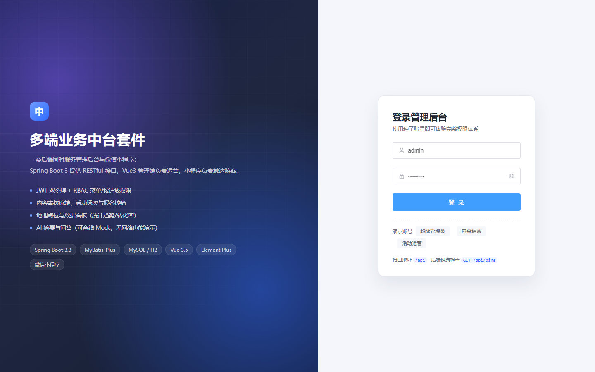
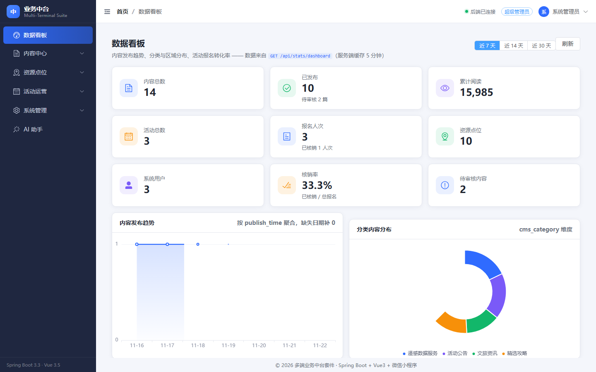
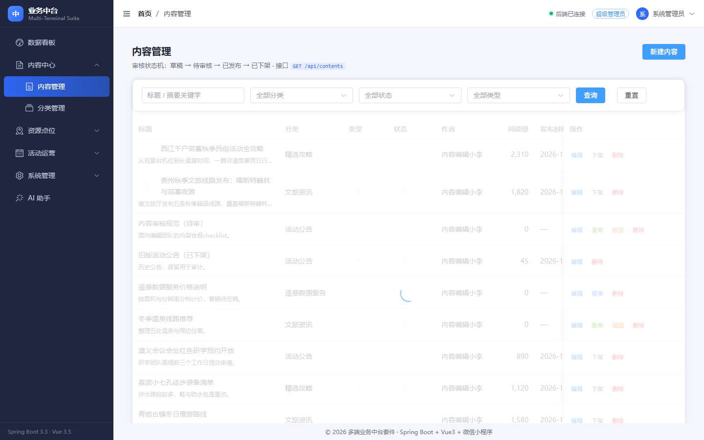
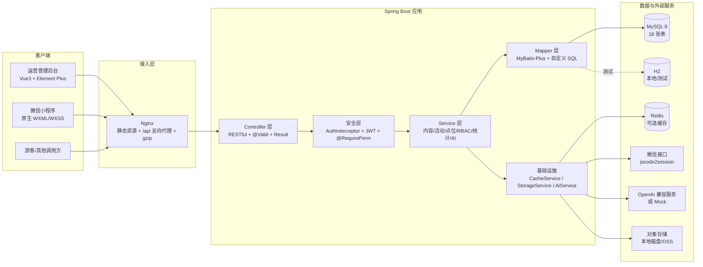

# 多端业务中台套件（Multi-Terminal Business Suite）

> 面向「数字内容 + 遥感数据服务 + 文旅活动」业务的**多端业务中台**：Spring Boot 后端 + Vue 3 运营管理后台 + 微信小程序客户端，一套 RBAC 权限模型贯穿三端。

`Java 21` · `Spring Boot 3.3.5` · `MyBatis-Plus` · `MySQL 8 / H2` · `JWT` · `Vue 3.5` · `Vite 5` · `TypeScript` · `Element Plus` · `Pinia` · `ECharts` · `微信小程序` · `Docker Compose` · `MIT`

## 界面预览

以下截图均为本项目本地真实运行、由 `scripts/capture-screenshots.mjs`（Edge headless + CDP）自动抓取，非设计稿。

**① 登录页**：演示账号一键填充，左侧为业务中台能力说明。



**② 数据看板**：9 项核心指标 + 趋势/分类占比/区域分布/场次转化率，数据来自真实 SQL 聚合。



**③ 内容管理**：分页、关键词/分类/状态/类型筛选、状态流转按钮（提审/发布/驳回/下架），列表为种子数据中的 14 条真实内容。



> 微信小程序端需要在「微信开发者工具」中运行，无法用浏览器截图；其页面与目录结构见
> [小程序端目录](#小程序端miniprogram) 与 [部署文档 · 小程序导入](docs/deployment.md#6-微信小程序导入与发布)。

## 1. 项目简介

多端业务中台套件是一个面向区域文旅与遥感数据服务企业的运营中台示例项目，包含三端：

| 端 | 目录 | 技术栈 | 使用者 |
|---|---|---|---|
| 后端服务 | [`backend/`](backend) | Java 21、Spring Boot 3.3.5、MyBatis-Plus、MySQL 8（测试 H2）、JWT、Spring AOP | 全部 |
| 运营管理后台 | [`frontend/`](frontend) | Vue 3.5、Vite 5、TypeScript、Element Plus、Pinia、Vue Router、ECharts、axios | 企业运营/编辑/管理员 |
| 微信小程序 | [`miniprogram/`](miniprogram) | 微信小程序原生（WXML/WXSS/JS） | 游客/小程序用户 |

核心业务涵盖：**内容中心**（草稿→待审→发布/驳回→下架的状态机）、**地理资源点位**（区域树、经纬度、附近点位距离计算）、**文旅活动**（活动/场次/名额并发扣减/报名核销）、**RBAC 权限**（用户-角色-菜单/按钮级权限 + 动态路由）、**统计看板**、**AI 辅助**（内容摘要/标题生成/内容库问答）。

## 2. 为什么做这个项目

**对标公司与岗位**：贵州派诺数海观澜数字产业发展有限公司 · **全栈开发工程师**。

该公司业务围绕「数字内容生产 + 卫星遥感数据处理与地理信息服务 + AI 应用 + 文旅/直播运营」展开，岗位 JD 要求：Java + Spring Boot/Spring MVC/MyBatis 后端开发、MySQL 数据库设计、Vue2/Vue3 前端、微信小程序开发、RESTful 接口设计、Git/Linux 部署。

**真实业务场景映射**：

- 企业需要在一个后台里同时管理**文旅资讯内容**（图文/图集/视频）、**遥感与文旅资源点位**（景区、人文古迹、遥感地块、服务设施）、**线下文旅活动与报名核销**；
- 内容岗、活动岗、管理员三种角色看到的菜单与按钮不同 → 需要**RBAC + 动态路由 + 按钮级权限**；
- 活动名额有限、报名存在并发 → 需要**名额条件更新 + 唯一键幂等**，不能超卖；
- 小程序是获客入口 → 需要**游客可浏览、登录后可报名、我的报名可查**的轻量客户端；
- 运营需要数据决策 → 需要**内容趋势、分类占比、区域分布、场次转化率**等聚合指标；
- 内容生产需要提效 → 需要**AI 摘要/标题生成与内容库问答**（可降级、可切换供应商）。

因此本项目不是 CRUD 堆砌，而是把「内容 + 地理 + 活动 + 权限 + 数据 + AI」六块能力按真实业务流程串成一条可演示、可测试、可部署的链路。

## 3. 功能清单

### 3.1 后端能力

- [x] 统一响应体 `Result<T>{code,message,data,traceId,timestamp}`、全局异常处理、`@Valid` 参数校验
- [x] 错误码字典（40001~50401），HTTP 状态码与业务码一致
- [x] JWT 双 token（access 7200s / refresh 604800s）+ 退出黑名单 + 401 自动续期
- [x] RBAC：用户、角色、菜单/按钮权限，`@RequirePerm` 切面鉴权、动态路由返回
- [x] 内容中心：分类树、标签、状态机（草稿/待审/已发布/已下架/已驳回）、浏览量
- [x] 地理点位：区域树、类型字典、边界框查询、Haversine 附近点位与距离文案
- [x] 活动运营：活动、场次、名额并发扣减、报名、取消回补、核销码核销与核销日志
- [x] 统计看板：总量、内容趋势、分类占比、区域分布、场次转化率（SQL 聚合）
- [x] AI 能力抽象：Mock Provider + OpenAI 兼容 Provider + 失败自动降级 + 简易 RAG 引用
- [x] 缓存抽象：内存实现（空值缓存防穿透、TTL 抖动防雪崩），预留 Redis
- [x] 对象存储抽象：本地磁盘实现，预留 OSS/S3
- [x] 微信登录（mock 模式，可切真实 `jscode2session`）、小程序用户自动注册
- [x] 系统信息接口 + 操作日志分页接口
- [x] 45 个单元/集成测试（鉴权、状态机、分页、地理计算、AI 降级、报名并发）

### 3.2 运营管理后台

- [x] 登录页（演示账号一键填充）、Token 持久化、退出登录
- [x] 后端驱动的动态路由菜单（`sys_menu.component` → `views/**` 组件映射）+ 无权限跳转提示
- [x] 数据看板：9 张指标卡 + 4 张 ECharts 图 + 7/14/30 天切换
- [x] 内容管理：分页/搜索/分类/状态/类型筛选、新增/编辑弹窗、提审/发布/驳回/下架/删除
- [x] 分类管理（树形表格）、资源点位管理（类型/区域/经纬度）、活动管理（含展开行场次管理）
- [x] 报名管理与核销（输入核销码 + 最近核销结果展示）
- [x] 用户管理（新建/编辑/重置密码/禁用）、角色权限（菜单树勾选授权）
- [x] 系统配置（运行时信息 + 操作日志分页）
- [x] AI 助手（摘要、标题、内容库问答）
- [x] axios 封装：token 注入、401 单飞刷新、统一错误 toast（含 traceId）、加载/空/错误三态
- [x] 页面级权限按钮（`auth.can('content:write')` 等）

### 3.3 微信小程序

- [x] 微信一键登录（`wx.login` → `/api/wx/login`），token/user 本地会话
- [x] 首页：分类入口 + 活动列表 + 内容流，支持下拉刷新
- [x] 内容列表：分类 tab、搜索、下拉刷新、上拉加载更多
- [x] 内容详情：`rich-text` 渲染正文、浏览量上报、分享
- [x] 个人中心：登录态、我的报名记录与统计、关于项目、退出登录

### 3.4 工程化

- [x] Docker Compose 一键编排（MySQL 8 + 后端 + Nginx 前端 + 可选 Redis）
- [x] 后端 / 前端多阶段 Dockerfile、Nginx 反代 + gzip + 静态资源缓存
- [x] `docs/` 7 篇文档（需求、架构、数据库、接口、部署、路线图、AI Coding 实践）
- [x] 真实运行截图（Edge headless 自动抓取，非占位图）
- [ ] 操作日志自动切面（当前为手动写入 + 演示数据）
- [ ] Playwright E2E、GitHub Actions CI（见 [roadmap](docs/roadmap.md)）

## 4. 技术栈

| 层 | 技术 | 版本 | 用途 |
|---|---|---|---|
| 后端框架 | Spring Boot | 3.3.5 | Web、AOP、配置、校验 |
| 语言 | Java | 21 | Records、模式匹配、虚拟线程可用 |
| ORM | MyBatis-Plus | 3.5.7 | 单表 CRUD、分页插件、逻辑删除 |
| 数据库 | MySQL / H2 | 8.0 / 2.2 | 生产 / 本地与测试（MODE=MySQL） |
| 认证 | JJWT | 0.12.6 | 双 token 签发与校验 |
| 密码 | PBKDF2（JDK） | — | 加盐迭代散列 |
| 缓存 | 内存 / Redis | — / 7 | 接口缓存、空值缓存、抖动过期 |
| AI | OpenAI 兼容 API + Mock | — | 摘要/标题/问答，可降级 |
| 前端框架 | Vue | 3.5 | Composition API |
| 构建 | Vite | 5.4 | 开发与打包 |
| 语言 | TypeScript | 5.6 | 类型安全 |
| UI | Element Plus | 2.8 | 后台组件库 |
| 状态 | Pinia | 2.2 | 认证态与权限 |
| 路由 | Vue Router | 4.4 | hash 路由 + 动态注册 |
| 图表 | ECharts | 5.5 | 看板可视化 |
| 请求 | axios | 1.7 | 拦截器、刷新、统一错误 |
| 小程序 | 微信小程序原生 | 基础库 3.5.5 | WXML/WXSS/JS |
| 部署 | Docker Compose / Nginx | — | 编排与反向代理 |

## 5. 系统架构



请求链路：`Nginx → AuthInterceptor（校验 Bearer token 并注入当前用户）→ PermissionAspect（校验 @RequirePerm）→ Controller → Service（事务/业务规则）→ Mapper → MySQL`，异常由 `GlobalExceptionHandler` 统一转为 `Result`，`traceId` 贯穿日志与响应。

## 6. 目录结构

```text
multi-terminal-business-suite/
├── backend/                        # Spring Boot 后端（Java 21）
│   ├── src/main/java/com/painuo/suite/
│   │   ├── controller/             # 12 个 REST 控制器
│   │   ├── service/                # 业务服务（内容/活动/RBAC/统计/AI/日志...）
│   │   ├── mapper/                 # MyBatis-Plus Mapper 与自定义 SQL
│   │   ├── entity/                 # 18 张表实体
│   │   ├── dto/                    # 请求/响应 DTO（Record）
│   │   ├── security/               # JWT、拦截器、权限注解与切面
│   │   ├── ai/                     # AI 抽象层（Mock / OpenAI 兼容）
│   │   ├── cache/                  # 缓存抽象（内存 / Redis 预留）
│   │   ├── storage/                # 对象存储抽象（本地 / OSS 预留）
│   │   ├── config/                 # 配置属性、Web、MyBatis、异步
│   │   └── common/                 # Result、错误码、异常、分页、工具
│   ├── src/main/resources/
│   │   ├── application.yml         # 主配置（profile 默认 local）
│   │   ├── application-local.yml   # H2 文件库 + 自动建表
│   │   ├── application-prod.yml    # MySQL + 文件日志
│   │   ├── application-test.yml    # H2 内存库（单元测试）
│   │   └── db/h2/                  # H2 版建表与种子数据
│   ├── src/test/java/              # 45 个测试
│   └── Dockerfile                  # 多阶段构建
├── frontend/                       # Vue 3 管理后台
│   ├── src/
│   │   ├── api/                    # axios 封装 + 各业务接口模块
│   │   ├── router/                 # hash 路由 + 后端动态路由注册 + 守卫
│   │   ├── stores/                 # Pinia 认证/权限仓库
│   │   ├── layout/                 # 侧栏布局与递归菜单
│   │   ├── views/                  # 10 个业务页面
│   │   ├── components/             # 三态容器、指标卡
│   │   ├── utils/                  # 格式化、状态字典
│   │   ├── types/                  # 与后端 DTO 对齐的 TS 类型
│   │   └── styles/                 # 设计变量与全局样式
│   ├── vite.config.ts              # /api、/uploads 代理 + 分包
│   ├── nginx.conf                  # 生产反向代理配置
│   └── Dockerfile                  # node 构建 + nginx 托管
├── miniprogram/                    # 微信小程序（原生）
│   ├── app.js / app.json / app.wxss
│   ├── utils/request.js            # wx.request 封装（token/错误/401）
│   ├── utils/auth.js               # wx.login 登录与会话
│   ├── utils/format.js             # 时间/数字/文案格式化
│   └── pages/                      # 登录、首页、列表、详情、我的（20 个文件）
├── db/                             # MySQL 8 建表与种子数据
├── docs/                           # 7 篇文档 + screenshots/
├── scripts/                        # 密码散列工具、截图脚本
├── docker-compose.yml              # MySQL + 后端 + 前端（+可选 Redis）
├── .env.example                    # 环境变量模板
└── README.md
```

## 7. 快速开始

### 7.1 前置要求

- JDK 21、Maven 3.9+
- Node.js 20+（推荐 24）、npm
- 可选：MySQL 8（不装也能跑，默认 H2）、Docker（可选）

### 7.2 后端（默认 H2，零依赖启动）

```bash
cd backend
mvn spring-boot:run
# 或：mvn -DskipTests package && java -jar target/business-suite-backend.jar
```

- 默认 profile 为 `local`：H2 文件库 `./data/suite`，启动时自动执行 `classpath:db/h2/schema.sql` 与 `data.sql`
- 健康检查：<http://127.0.0.1:8080/api/ping>
- H2 控制台：<http://127.0.0.1:8080/h2-console>（JDBC URL `jdbc:h2:file:./data/suite`，用户 `sa`，密码空）

### 7.3 前端

```bash
cd frontend
npm install
npm run dev          # http://127.0.0.1:5173/#/login
```

Vite 已配置 `/api`、`/uploads` 代理到 `http://127.0.0.1:8080`，无需额外跨域配置。

### 7.4 生产模式（MySQL）

```bash
mysql -uroot -p < db/schema.sql
mysql -uroot -p business_suite < db/data.sql
export SPRING_PROFILES_ACTIVE=prod DB_HOST=127.0.0.1 DB_NAME=business_suite \
       DB_USERNAME=suite DB_PASSWORD='***' APP_JWT_SECRET='至少32字节的随机密钥'
cd backend && mvn -DskipTests package && java -jar target/business-suite-backend.jar
```

### 7.5 Docker Compose

```bash
cp .env.example .env      # 填写 APP_JWT_SECRET、MYSQL_ROOT_PASSWORD
docker compose up -d --build
# 管理后台 http://127.0.0.1:8081
```

### 7.6 微信小程序

微信开发者工具 → 导入项目 → 目录选择 `miniprogram/`（不是仓库根目录）→ AppID 选测试号 →
详情 → 本地设置 → 勾选「不校验合法域名」（`project.config.json` 已预设 `urlCheck: false`）。
详见 [部署文档 · 小程序导入与发布](docs/deployment.md#6-微信小程序导入与发布)。

## 8. 默认账号

| 账号 | 密码 | 角色 | 可见范围 |
|---|---|---|---|
| `admin` | `admin123` | 超级管理员 | 全部菜单 + 系统配置 + 全部按钮 |
| `editor` | `editor123` | 内容运营 | 数据看板、内容中心（内容/分类）、AI 助手 |
| `operator` | `operator123` | 活动运营 | 数据看板、资源点位、活动运营（活动/报名核销） |

> 密码在数据库中以 PBKDF2 散列存储；如需生成新密码散列，可用 `node scripts/hash-password.mjs <明文>`。

## 9. 主要接口

完整接口见 [docs/api.md](docs/api.md)，以下为核心链路：

| 方法 | 路径 | 鉴权 | 说明 |
|---|---|---|---|
| POST | `/api/auth/login` | 公开 | 账号密码登录，返回双 token + 用户权限 |
| GET | `/api/auth/routes` | 登录 | 当前角色可见的动态路由树 |
| GET | `/api/contents` | `content:list` | 内容分页（关键词/分类/状态/类型） |
| POST | `/api/contents/{id}/publish` | `content:review` | 内容发布（状态机校验） |
| GET | `/api/points` | `geo:list` | 资源点位分页 |
| GET | `/api/public/points/nearby` | 公开 | 附近点位（经纬度 + 半径 + 距离） |
| POST | `/api/signups` | 登录 | 活动报名（名额并发扣减） |
| POST | `/api/signups/verify` | `signup:verify` | 核销码核销 |
| GET | `/api/stats/dashboard` | `stats:view` | 看板聚合数据 |
| POST | `/api/ai/summary` | `ai:use` | AI 生成内容摘要 |
| GET | `/api/wx/login`（POST） | 公开 | 小程序 code 登录（mock 可演示） |

示例：

```bash
TOKEN=$(curl -s -X POST http://127.0.0.1:8080/api/auth/login \
  -H "Content-Type: application/json" \
  -d '{"username":"admin","password":"admin123"}' | sed -E 's/.*"accessToken":"([^"]+)".*/\1/')
curl -s "http://127.0.0.1:8080/api/stats/dashboard?days=7" -H "Authorization: Bearer $TOKEN"
```

## 10. 测试

### 10.1 后端

```bash
cd backend
mvn test
```

**实测结果**：`Tests run: 45, Failures: 0, Errors: 0, Skipped: 0`，`BUILD SUCCESS`。

| 测试类 | 用例数 | 覆盖点 |
|---|---|---|
| `AuthApiTest` | 9 | 登录/刷新/登出、未授权 401、无权限 403、按角色过滤动态路由 |
| `ContentStatusTest` | 7 | 内容状态机合法/非法流转、错误码 |
| `GeoUtilsTest` | 5 | Haversine 距离、边界框、距离文案格式化 |
| `PageQueryTest` | 4 | 分页参数解析、上限裁剪、排序白名单 |
| `AiServiceTest` / `AiFallbackTest` | 4 + 1 | Mock 返回、引用抽取、上游异常降级 |
| `ContentServiceTest` | 8 | 内容 CRUD、分类过滤、标签处理、发布流程 |
| `SignupConcurrencyTest` | 7 | 名额并发扣减不超卖、重复报名幂等、取消回补、核销 |

测试使用 H2 内存库与 `classpath:db/h2/*.sql`，**不依赖任何外部服务**，可离线运行。

### 10.2 前端

```bash
cd frontend
npm run build          # vue-tsc --noEmit && vite build
```

构建产物输出到 `frontend/dist/`，`npm run preview` 可在 `127.0.0.1:4173` 预览（已带 `/api` 代理）。
本地已验证 `npm.cmd install` 与 `npm.cmd run build` 均成功。

### 10.3 截图脚本

```bash
# 需先启动后端(8080)与前端 preview(4173)
node scripts/capture-screenshots.mjs
# 输出 docs/screenshots/01-login.png、02-dashboard.png、03-content-list.png
```

## 11. 与岗位要求的对应关系

岗位：**贵州派诺数海观澜数字产业发展有限公司 · 全栈开发工程师**

| JD 要求 | 本项目落点 |
|---|---|
| Java 基础与面向对象 | `backend/src/main/java/com/painuo/suite/`：Record DTO、枚举状态机、策略式 AI/缓存/存储抽象 |
| Spring Boot / Spring MVC | `controller/`（12 个控制器）、`config/WebConfig`、`common/GlobalExceptionHandler`、`GlobalResponse` 统一响应 |
| MyBatis / MyBatis-Plus | `mapper/`（BaseMapper + 自定义聚合 SQL）、`config/MyBatisPlusConfig` 分页与逻辑删除 |
| MySQL 数据库设计 | `db/schema.sql`（18 张表）、`docs/database.md`（ER 图 + 逐表字段 + 索引说明） |
| RESTful 接口设计 | `docs/api.md`：统一前缀、资源化路径、分页规范、错误码字典（40001~50401） |
| 权限与安全 | `security/`：JWT 双 token、`@RequirePerm` 切面、退出黑名单、PBKDF2 密码 |
| Vue2/Vue3 前端开发 | `frontend/src/`：Vue 3 Composition API + TS，10 个业务页面、组件化 `components/` |
| Vue Router / Pinia | `router/index.ts`（hash 路由 + 动态注册 + 守卫）、`stores/auth.ts` |
| Element Plus / ECharts | `views/**` 表单表格弹窗、`views/dashboard/index.vue` 四图联动 |
| RESTful 前后端联调 | `api/request.ts` 拦截器（token/401 刷新/统一错误）、`vite.config.ts` 代理 |
| 微信小程序开发 | `miniprogram/`：5 个页面四件套、`wx.request` 封装、`wx.login`、生命周期、下拉刷新/上拉加载、本地存储 |
| 微信小程序生命周期与 API | 各页 `onLoad/onShow/onPullDownRefresh/onReachBottom`、`wx.showToast/showModal/navigateTo/switchTab/setStorage` |
| Git 使用 | 清晰的分层目录与提交边界（后端/前端/小程序/文档/脚本分离），`.gitignore` 排除构建产物 |
| Linux 部署 | `docs/deployment.md`：systemd 服务、Nginx 反代与 gzip、logback 日志滚动、rsync 发布 |
| Docker / 容器化 | `docker-compose.yml`、`backend/Dockerfile`、`frontend/Dockerfile`、`frontend/nginx.conf` |
| 并发与事务 | `SignupService` 名额条件更新 + 唯一键幂等 + `@Transactional`，`SignupConcurrencyTest` 并发验证 |
| AI 应用集成 | `ai/`：Provider 抽象、OpenAI 兼容实现、Mock 降级、简易 RAG 引用 |
| Python 数据处理 | 未覆盖（本项目为 Java 全栈方向，遥感数据处理中的 Python 部分未展开） |

## 12. 后续规划

- **v1.1**：`@Log` 注解 + AOP 自动操作日志、登录限流与参数脱敏、前端 `useTable` 组合式封装、Playwright E2E、GitHub Actions CI
- **v1.2**：报名支付与退款流水、WebSocket 实时看板与点位热力图、遥感地块 GeoJSON 绘制与面积计算、小程序订阅消息
- **v2.0**：服务拆分与网关、Prometheus + Grafana 可观测性、多租户行级隔离、小程序升级 uni-app 一套代码多端输出

详细版本计划见 [docs/roadmap.md](docs/roadmap.md)。

## 文档索引

| 文档 | 内容 |
|---|---|
| [docs/requirements.md](docs/requirements.md) | 业务背景、角色与用例、功能清单、JD 逐条映射、验收实测 |
| [docs/architecture.md](docs/architecture.md) | 总体架构、分层约束、6 个关键流程时序/状态图、部署拓扑 |
| [docs/database.md](docs/database.md) | ER 图、18 张表逐字段说明、索引与性能、MySQL/H2 方言差异 |
| [docs/api.md](docs/api.md) | 全部接口、统一响应、错误码字典、curl 演示 |
| [docs/deployment.md](docs/deployment.md) | 本地/H2、MySQL、Docker Compose、Linux systemd + Nginx、小程序导入发布 |
| [docs/roadmap.md](docs/roadmap.md) | 已交付范围、已知未完成项、版本规划 |
| [docs/ai-coding.md](docs/ai-coding.md) | AI 辅助开发工作流、review 清单、真实踩坑与修正 |

## License

[MIT](LICENSE) © 2026 zhoushiba
