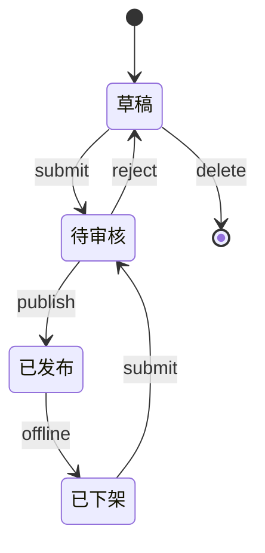

# 接口文档 · 多端业务中台套件

- 基础前缀：`/api`
- 鉴权：除白名单外均需 `Authorization: Bearer <accessToken>`
- 白名单：`POST /api/auth/login`、`POST /api/auth/refresh`、`POST /api/wx/login`、`GET /api/public/**`、`GET /api/ping`、`/uploads/**`
- 内容类型：`application/json;charset=UTF-8`
- 时间格式：`yyyy-MM-dd HH:mm:ss`（时区 `Asia/Shanghai`）
- 分页参数统一：`page`（从 1 开始，默认 1）、`size`（默认 10，最大 100）

## 1. 统一响应结构

```json
{
  "code": 0,
  "message": "ok",
  "data": {},
  "traceId": "4f9c2b3e8a7d4c1f",
  "timestamp": "2026-11-21 22:30:00"
}
```

- `code = 0` 表示成功，其它为失败；HTTP 状态码取错误码前三位（如 `40401` → HTTP 404）。
- `traceId` 与后端日志、`operation_log.trace_id` 对应，排查问题时可凭此串联。

分页响应 `data`：

```json
{
  "list": [],
  "page": 1,
  "size": 10,
  "total": 14,
  "pages": 2,
  "hasNext": true
}
```

## 2. 错误码字典

| code | HTTP | 含义 |
|---|---|---|
| 40001 | 400 | 参数校验失败 |
| 40101 | 401 | 未登录 |
| 40102 | 401 | accessToken 过期 |
| 40103 | 401 | accessToken 非法 |
| 40104 | 401 | refreshToken 失效，需要重新登录 |
| 40301 | 403 | 无操作权限 |
| 40401 | 404 | 资源不存在 |
| 40901 | 409 | 数据冲突 |
| 42201 | 422 | 内容状态不允许该操作 |
| 42202 | 422 | 名额已售罄 |
| 42203 | 422 | 重复报名 |
| 42204 | 422 | 报名已截止/未开始 |
| 42205 | 422 | 报名状态不允许该操作 |
| 50001 | 500 | 服务器内部错误 |
| 50201 | 502 | AI 服务调用失败 |
| 50301 | 503 | 存储服务失败 |
| 50401 | 504 | 微信接口失败 |

## 3. 认证与账号

| 方法 | 路径 | 权限 | 说明 |
|---|---|---|---|
| POST | `/auth/login` | 公开 | 后台账号密码登录 |
| POST | `/auth/refresh` | 公开 | 用 refreshToken 换新 accessToken |
| POST | `/auth/logout` | 登录 | 退出并拉黑当前 jti |
| GET | `/auth/profile` | 登录 | 当前用户信息 |
| GET | `/auth/routes` | 登录 | 当前角色可见的动态路由树 |
| POST | `/wx/login` | 公开 | 小程序 code 登录（mock 模式无需真实 code） |
| GET | `/ping` | 公开 | 健康检查 |
| GET | `/system/info` | 登录 | 运行时信息（版本/JVM/缓存/AI/存储/微信模式等） |
| GET | `/system/logs` | 登录 | 操作日志分页（`keyword`/`page`/`size`） |

### 3.1 登录

```
POST /api/auth/login
{ "username": "admin", "password": "admin123" }
```

响应 `data`：

```json
{
  "accessToken": "eyJhbGciOiJIUzI1NiJ9...",
  "refreshToken": "eyJhbGciOiJIUzI1NiJ9...",
  "expiresIn": 7200,
  "user": {
    "id": 1, "username": "admin", "nickname": "超级管理员",
    "avatar": null, "phone": "13800000001",
    "roles": ["admin"],
    "permissions": ["content:list", "content:write", "stats:view", "..."]
  }
}
```

- accessToken 有效期 7200 秒，refreshToken 604800 秒，issuer `business-suite`。
- 前端在 accessToken 过期（`40102`）时自动用 refreshToken 静默续期一次。

### 3.2 动态路由

```
GET /api/auth/routes
```

响应 `data` 为路由树（`type: 0` 目录、`1` 菜单，按钮节点不返回）：

```json
[
  {
    "id": 1, "parentId": 0, "name": "数据看板", "path": "/dashboard",
    "component": "dashboard/index", "icon": "DataBoard",
    "perm": "stats:view", "type": 1, "sort": 1, "children": []
  },
  {
    "id": 2, "parentId": 0, "name": "内容中心", "path": "/content",
    "component": null, "icon": "Document", "perm": null, "type": 0, "sort": 2,
    "children": [
      { "id": 3, "parentId": 2, "name": "内容管理", "path": "/content/list",
        "component": "content/index", "perm": "content:list", "type": 1, "children": [] }
    ]
  }
]
```

前端 `registerDynamicRoutes()` 用 `component` 去 `import.meta.glob('../views/**/*.vue')` 中匹配组件，因此**菜单的 component 字段与 views 目录必须一一对应**。

## 4. 内容中心

| 方法 | 路径 | 权限 | 说明 |
|---|---|---|---|
| GET | `/contents` | content:list | 分页（`keyword`/`categoryId`/`status`/`contentType`/`page`/`size`） |
| GET | `/contents/{id}` | content:list | 详情（含完整 body、tags） |
| POST | `/contents` | content:write | 新建草稿 |
| PUT | `/contents/{id}` | content:write | 编辑 |
| DELETE | `/contents/{id}` | content:write | 逻辑删除 |
| POST | `/contents/{id}/submit` | content:write | 提交审核（0 → 1） |
| POST | `/contents/{id}/publish` | content:review | 发布（1 → 2，写 publish_time） |
| POST | `/contents/{id}/reject` | content:review | 驳回（1 → 0），body `{"remark": "..."}` |
| POST | `/contents/{id}/offline` | content:review | 下架（2 → 3） |
| GET | `/categories` | 登录 | 分类树 |
| POST/PUT/DELETE | `/categories[/{id}]` | content:write | 分类增删改 |
| GET | `/tags` | 登录 | 标签列表 |

新建/编辑请求体：

```json
{
  "title": "贵州秋季文旅线路推荐",
  "summary": "摘要",
  "body": "<p>富文本正文</p>",
  "coverUrl": "/covers/a.jpg",
  "categoryId": 1,
  "contentType": "article",
  "topFlag": false,
  "sort": 0,
  "tags": ["贵州", "文旅"]
}
```

内容状态机（后端 `ContentStatus` 枚举强校验，非法流转返回 `42201`）：



## 5. 资源点位（地理遥感）

| 方法 | 路径 | 权限 | 说明 |
|---|---|---|---|
| GET | `/points` | geo:list | 后台分页（`keyword`/`regionId`/`type`） |
| POST/PUT/DELETE | `/points[/{id}]` | geo:write | 增删改 |
| GET | `/regions` | 登录 | 区域树（省/市） |
| GET | `/public/regions` | 公开 | 区域树 |
| GET | `/public/points/nearby` | 公开 | 附近点位：`lng`/`lat`/`radius`/`type`/`limit` |
| GET | `/public/points/map` | 公开 | 地图点位：`type`/`regionId` |

保存请求体：

```json
{
  "name": "黄果树瀑布", "regionId": 2, "type": "scenic",
  "lng": 105.6672, "lat": 25.9901,
  "address": "贵州省安顺市镇宁县", "coverUrl": "",
  "summary": "亚洲第一大瀑布", "status": 1
}
```

`type` 取值：`scenic` 景区、`heritage` 人文古迹、`plot` 遥感地块、`service` 服务设施。

附近点位响应（`distanceMeters` 由 Haversine 公式计算）：

```json
[
  { "id": 1, "name": "甲秀楼", "type": "heritage", "typeText": "人文古迹",
    "regionName": "贵阳市", "lng": 106.7163, "lat": 26.5678,
    "distanceMeters": 1832.4, "distanceText": "1.8km" }
]
```

## 6. 活动与报名

| 方法 | 路径 | 权限 | 说明 |
|---|---|---|---|
| GET | `/activities` | activity:list | 分页（`keyword`/`status`） |
| GET | `/activities/{id}` | 登录 | 详情（含场次） |
| POST/PUT/DELETE | `/activities[/{id}]` | activity:write | 增删改 |
| POST | `/activities/{id}/sessions` | activity:write | 新增场次 |
| PUT/DELETE | `/sessions/{id}` | activity:write | 场次改/删 |
| POST | `/signups` | 登录 | 报名（并发扣减名额） |
| GET | `/signups/mine` | 登录 | 我的报名（`status`/`page`/`size`） |
| DELETE | `/signups/{id}` | 登录 | 取消报名（回补名额） |
| GET | `/signups` | signup:list | 报名单分页（`activityId`/`sessionId`/`status`/`keyword`） |
| POST | `/signups/verify` | signup:verify | 核销，body `{"code": "..."}` |

报名请求体与响应：

```json
{ "activityId": 1, "sessionId": 1, "contactName": "张三", "contactPhone": "13800001111" }
```

```json
{ "id": 4, "activityId": 1, "sessionId": 1, "code": "SUITE7K2M9Q",
  "status": 1, "statusText": "已报名", "signupTime": "2026-11-21 20:10:00" }
```

并发控制：`UPDATE activity_session SET remain = remain - 1 WHERE id = ? AND remain > 0`，
影响行数为 0 → `42202`；重复报名由唯一键 `(session_id, user_id, status)` 兜底 → `42203`。

核销响应：

```json
{ "signupId": 3, "activityTitle": "贵阳城市徒步", "contactName": "李四",
  "contactPhone": "13800002222", "status": 2, "statusText": "已核销",
  "verifyTime": "2026-11-21 21:00:00" }
```

## 7. 统计看板

| 方法 | 路径 | 权限 | 说明 |
|---|---|---|---|
| GET | `/stats/dashboard` | stats:view | 看板数据（`days` 默认 7，支持 7/14/30） |
| GET | `/stats/totals` | stats:view | 仅 9 项总量 |

```json
{
  "totals": {
    "contentTotal": 14, "publishedTotal": 10, "pendingTotal": 2,
    "activityTotal": 3, "signupTotal": 3, "verifiedTotal": 1,
    "pointTotal": 10, "userTotal": 3, "viewTotal": 1268
  },
  "contentTrend": [{ "date": "2026-11-15", "count": 2 }],
  "categoryRank": [{ "name": "文旅资讯", "value": 6 }],
  "regionDistribution": [{ "name": "贵阳市", "value": 4 }],
  "activityConversion": [
    { "activityTitle": "贵阳城市徒步", "sessionName": "上午场",
      "capacity": 30, "signed": 28, "conversionRate": 93.33 }
  ]
}
```

> `conversionRate` 为百分比数值（`93.33` 表示 93.33%），SQL 侧 `ROUND(COUNT(...) * 100.0 / capacity, 2)`。

## 8. AI 助手

| 方法 | 路径 | 权限 | 说明 |
|---|---|---|---|
| POST | `/ai/summary` | ai:use | 生成内容摘要 |
| POST | `/ai/titles` | ai:use | 生成候选标题 |
| POST | `/ai/chat` | ai:use | 基于内容库的简易 RAG 问答 |

```json
{ "title": "标题", "body": "正文", "contentId": 1 }
```

```json
{
  "content": "生成结果",
  "provider": "mock", "model": "gpt-4o-mini",
  "promptTokens": 120, "completionTokens": 80,
  "latencyMs": 15, "fallback": false,
  "references": [{ "contentId": 1, "title": "参考文档", "snippet": "片段" }]
}
```

默认 `app.ai.provider=mock`，无需外部 Key 即可演示；切换到 OpenAI 兼容服务只需配置
`APP_AI_PROVIDER=openai`、`APP_AI_BASE_URL`、`APP_AI_API_KEY`、`APP_AI_MODEL`。
上游异常时自动降级为本地 Mock 结果并置 `fallback=true`（`AiFallbackTest` 覆盖）。

## 9. 用户与角色权限

| 方法 | 路径 | 权限 | 说明 |
|---|---|---|---|
| GET | `/users` | user:list | 用户分页（`keyword`/`status`） |
| POST/PUT/DELETE | `/users[/{id}]` | user:write | 增删改 |
| POST | `/users/{id}/reset-password` | user:write | 重置密码 `{"password": "..."}` |
| GET | `/roles` | role:list | 角色列表 |
| POST/PUT/DELETE | `/roles[/{id}]` | role:write | 增删改（含 menuIds 授权） |
| GET | `/menus` | role:list | 全部菜单树（含按钮节点，供授权勾选） |

用户保存请求体：

```json
{ "username": "editor2", "password": "editor123",
  "nickname": "内容编辑", "phone": "13800003333",
  "status": 1, "roleIds": [2] }
```

角色保存请求体：

```json
{ "code": "editor", "name": "内容运营", "remark": "内容中心全流程",
  "sort": 2, "menuIds": [2, 3, 4, 14, 15] }
```

## 10. 公开接口（小程序 / 游客）

| 方法 | 路径 | 说明 |
|---|---|---|
| GET | `/public/contents` | 已发布内容分页（`categoryId`/`keyword`/`sort`/`page`/`size`） |
| GET | `/public/contents/{id}` | 内容详情 |
| POST | `/public/contents/{id}/view` | 阅读量 +1 |
| GET | `/public/categories` | 分类 |
| GET | `/public/tags` | 标签 |
| GET | `/public/activities` | 活动列表 |
| GET | `/public/activities/{id}` | 活动详情（含场次余量） |
| GET | `/public/regions` | 区域树 |
| GET | `/public/points/nearby` | 附近点位 |
| GET | `/public/points/map` | 地图点位 |

## 11. curl 演示链路

```bash
# 1. 登录拿 token
curl -s -X POST http://127.0.0.1:8080/api/auth/login \
  -H "Content-Type: application/json" \
  -d '{"username":"admin","password":"admin123"}'

# 2. 带 token 查内容列表
TOKEN=$(curl -s -X POST http://127.0.0.1:8080/api/auth/login \
  -H "Content-Type: application/json" \
  -d '{"username":"admin","password":"admin123"}' | sed -E 's/.*"accessToken":"([^"]+)".*/\1/')
curl -s "http://127.0.0.1:8080/api/contents?page=1&size=5" -H "Authorization: Bearer $TOKEN"

# 3. 看板统计
curl -s "http://127.0.0.1:8080/api/stats/dashboard?days=7" -H "Authorization: Bearer $TOKEN"

# 4. 公开内容（免登录）
curl -s "http://127.0.0.1:8080/api/public/contents?page=1&size=3"
```

## 12. 前后端约定

- 前端 `frontend/src/api/*.ts` 与本文档一一对应，`request.ts` 统一注入 token、处理 `401` 刷新与错误 toast。
- 后端字段名即前端 `types/api.ts` 中的 camelCase 字段名（Jackson 默认序列化），无需额外转换。
- 新增接口时同步更新：`docs/api.md`、`frontend/src/api/`、`frontend/src/types/api.ts`。
