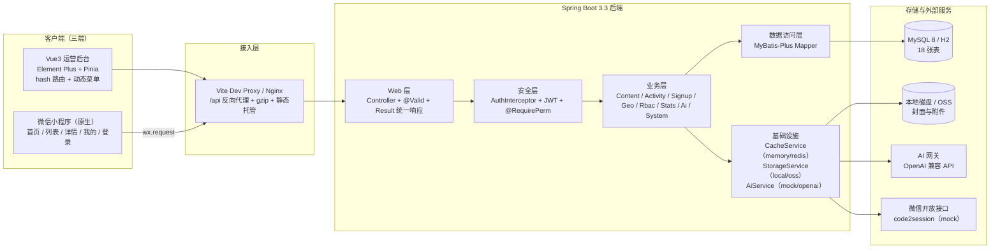
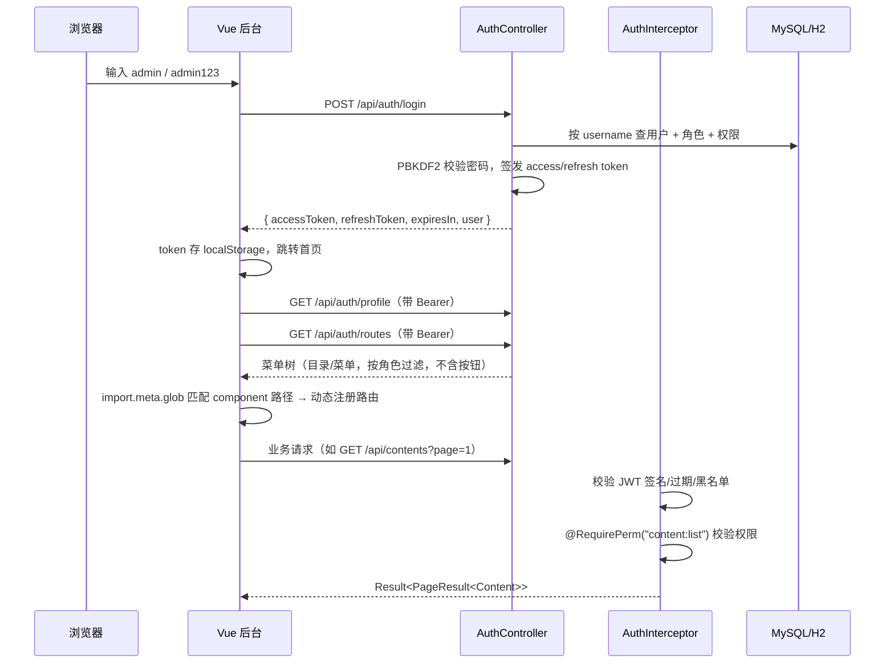
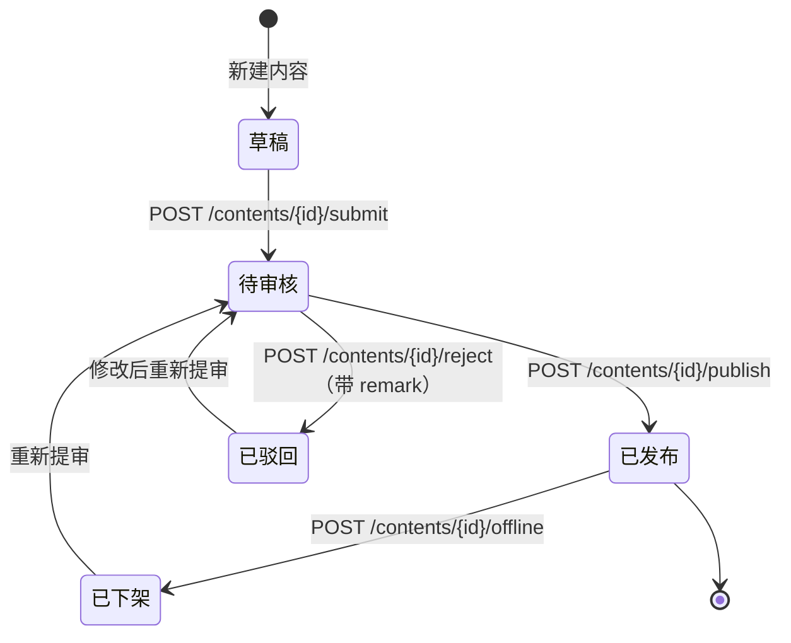
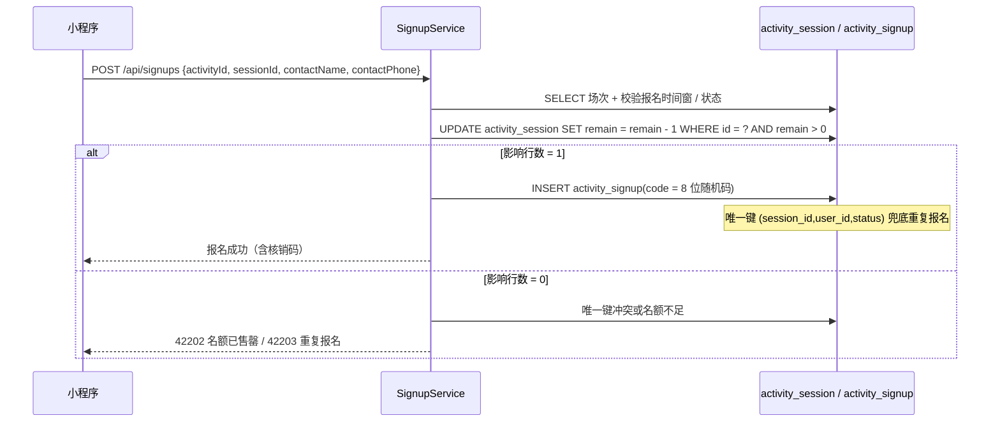
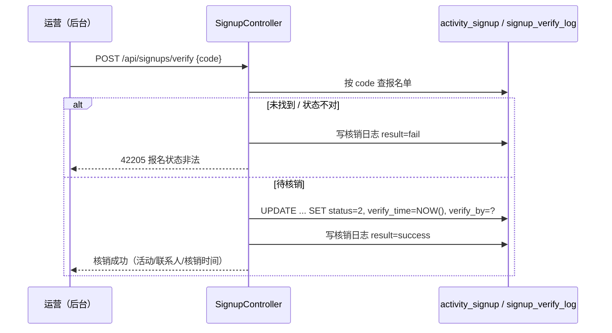
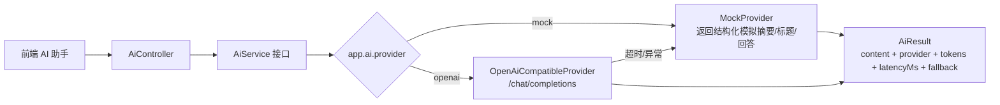
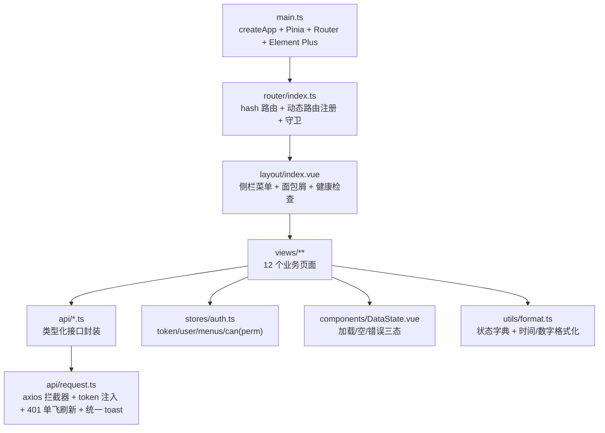
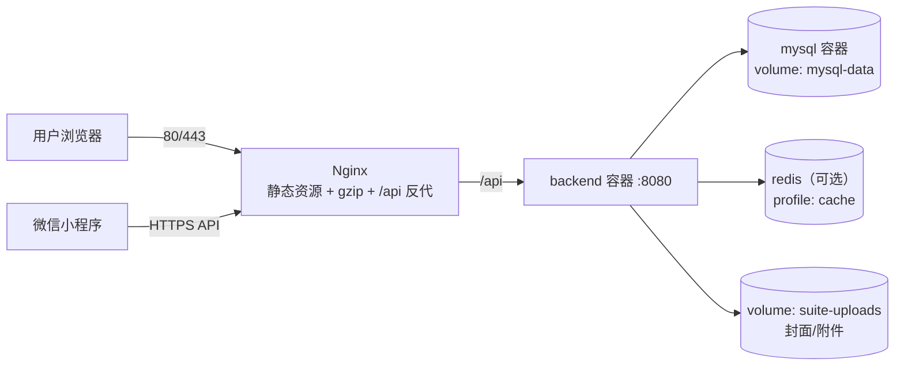

# 架构设计 · 多端业务中台套件

## 1. 总体架构



三端职责：

| 端 | 技术 | 职责 | 鉴权方式 |
|---|---|---|---|
| 运营后台 | Vue 3.5 + Vite 5 + TS + Pinia + Element Plus + ECharts | 内容/点位/活动/报名/用户/角色/看板/AI | JWT（`Authorization: Bearer`）+ 动态菜单 + 按钮权限 |
| 微信小程序 | 微信原生（WXML/WXSS/JS） | 内容浏览、活动查看、我的报名 | JWT（`wx.login` 换 token） |
| 后端 | Spring Boot 3.3.5 + MyBatis-Plus + H2/MySQL | RESTful API、权限、统计、第三方适配 | 拦截器 + 注解鉴权 |

## 2. 后端分层与模块

```
backend/src/main/java/com/painuo/suite/
├── SuiteApplication.java          # 启动类（@ConfigurationPropertiesScan）
├── controller/                    # 12 个控制器：只做参数接收、校验、调用 service
├── service/                       # 领域服务：状态机、并发扣减、聚合统计、权限装配
├── mapper/                        # MyBatis-Plus Mapper（21 个）
├── entity/                        # 18 个实体，与 18 张表一一对应
├── dto/                           # 请求/响应对象（record），与控制层契约绑定
├── common/                        # Result / PageQuery / PageResult / 错误码 / 全局异常
├── security/                      # JWT 工具、AuthInterceptor、@RequirePerm、PermAspect、登录上下文
├── cache/                         # CacheService 抽象 + Memory/Redis 实现 + 防穿透/防雪崩
├── ai/                            # AiService 抽象 + MockProvider + OpenAI 兼容 Provider + RAG 检索
├── storage/                       # StorageService 抽象 + 本地实现 + OSS 实现
└── config/                        # AppProperties、Web 配置、CORS、Jackson 时间格式
```

分层约束：

1. **Controller 不写业务逻辑**：只做参数绑定、`@Valid` 校验、调用 service、包装 `Result`。
2. **Service 承担领域规则**：内容状态机、报名并发、核销幂等、统计聚合、权限装配。
3. **Mapper 负责 SQL**：分页走 MyBatis-Plus `Page`，统计类复杂 SQL 写在 `StatsMapper`。
4. **基础设施可替换**：缓存、存储、AI 三个能力都是「接口 + 多个实现 + 配置切换」，保证无外部依赖也能启动。

统一响应与错误码：

```java
// 成功
{ "code": 0, "message": "ok", "data": {...}, "traceId": "a1b2c3...", "timestamp": 1763740000000 }

// 失败：HTTP 状态码取错误码前三位（40001 → 400，40101 → 401，50001 → 500）
{ "code": 40001, "message": "标题不能为空", "data": null, "traceId": "a1b2c3...", "timestamp": 1763740000000 }
```

## 3. 关键流程

### 3.1 登录 + 动态菜单 + 按钮权限



- 前端守卫：无 token → `/login?redirect=...`；首次进入调 `profile + routes` 完成初始化；`meta.perm` 不满足跳 404（带 `perm` 提示缺哪个权限）。
- 按钮权限：`auth.can('content:write')` 控制新增/编辑按钮渲染；后端 `@RequirePerm` 才是最终防线。

### 3.2 内容审核状态机



状态机由 `ContentService` 与枚举 `ContentStatus` 共同保证，非法流转返回 `42201`（内容状态非法），前端按钮也按状态隐藏，形成双保险。

### 3.3 报名抢名额（并发安全）



并发测试 `SignupConcurrencyTest` 用多线程同时报名同一场次，断言「成功数 == 库存」且 `remain` 不为负。

### 3.4 核销流程



### 3.5 AI 能力降级



简易 RAG：`AiService` 先按关键字从 `cms_content` 检索命中的已发布内容（最多 `max-context-items` 条），拼进 prompt，返回结果里带 `references`（内容 id/标题/片段），前端展示引用来源。

### 3.6 缓存策略

| 场景 | 策略 | 参数 |
|---|---|---|
| 内容详情热点 | 读缓存 → miss 查库 → 回填 | `default-ttl-seconds=300` |
| 查询不存在的数据 | 缓存空值，防止穿透 | `null-value-ttl-seconds=60` |
| 大量 key 同时过期 | TTL 抖动 | `ttl-jitter-ratio=0.2` |
| 无 Redis 环境 | 内存实现（`ConcurrentHashMap` + 定时清理） | `app.cache.type=memory` |
| 多实例部署 | Redis 实现 | `app.cache.type=redis` |

## 4. 前端架构（Vue 3）



关键设计：

1. **动态路由**：菜单由后端下发，`import.meta.glob('../views/**/*.vue')` 做组件懒加载映射，新增页面只需加文件 + 插菜单记录。
2. **401 单飞刷新**：模块级 `refreshPromise` 保证并发 401 只触发一次刷新，刷新成功后重放原请求，失败统一清理并跳登录。
3. **错误可定位**：后端 `Result.traceId` 透传到 toast，用户报错时可直接拿 traceId 查日志。
4. **样式体系**：`styles/index.css` 用 CSS 变量定义主题色/圆角/阴影，页面统一 `.page / .panel / .filter-bar / .table-footer` 工具类。

## 5. 小程序端架构

```
miniprogram/
├── app.js / app.json / app.wxss     # 全局配置、tabBar、全局样式
├── utils/request.js                 # wx.request 封装：Bearer token、统一错误、401 跳登录
├── utils/auth.js                    # wx.login → /api/wx/login、会话读写、ensureLogin
├── utils/format.js                  # 时间/状态/数字格式化，富文本降级
└── pages/
    ├── index/index                  # 首页：搜索 + 分类入口 + 活动 + 精选内容
    ├── content/list                 # 列表：分类 tab + 搜索 + 下拉刷新 + 上拉加载
    ├── content/detail               # 详情：rich-text 正文 + 阅读量 +1 + 分享
    ├── mine/index                   # 我的：登录态、报名统计、我的报名
    └── login/index                  # 登录：wx.login 一键登录 + 演示提示
```

生命周期使用：`onLoad`（取参数、首屏加载）、`onShow`（返回页面刷新）、`onPullDownRefresh`（下拉刷新）、`onReachBottom`（上拉加载）、`onShareAppMessage`（分享）。

## 6. 部署拓扑



本地开发：`vite dev`（5173）`proxy /api` → 后端 8080，后端 `local` profile 用 H2 文件库；
生产：`docker compose` 起 MySQL + 后端 + Nginx，后端 `prod` profile 读环境变量（见 `.env.example`）。
