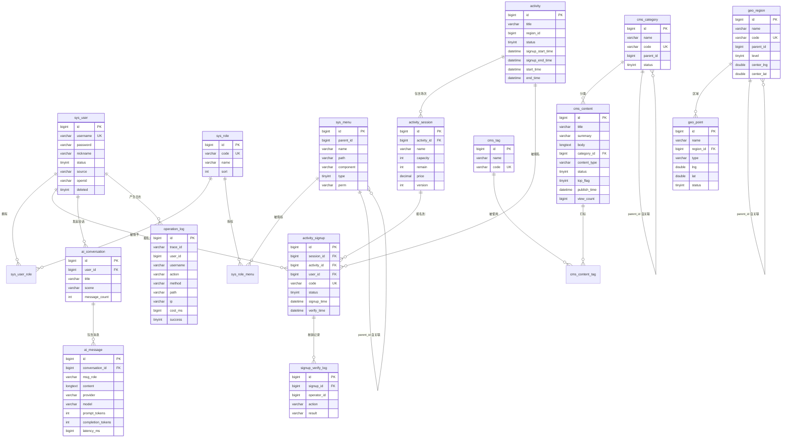

# 数据库设计 · 多端业务中台套件

- 生产方言：**MySQL 8.0**（`db/schema.sql` + `db/data.sql`）
- 本地/测试方言：**H2 2.x（MODE=MySQL）**（`backend/src/main/resources/db/h2/schema.sql` + `data.sql`），字段与 MySQL 完全同构
- 共 **18 张表**，逻辑删除统一用 `deleted TINYINT DEFAULT 0`，时间统一 `Asia/Shanghai`
- 金额统一 `DECIMAL(10,2)`（避免浮点误差），经纬度用 `DOUBLE`

## 1. ER 图



## 2. 系统与权限（5 张）

### 2.1 `sys_user` 后台用户

| 字段 | 类型 | 允许空 | 默认 | 说明 |
|---|---|---|---|---|
| id | BIGINT UNSIGNED | 否 | 自增 | 主键 |
| username | VARCHAR(64) | 否 | — | 登录名，唯一 `uk_sys_user_username` |
| password | VARCHAR(200) | 否 | — | PBKDF2 散列串，格式 `pbkdf2$迭代$盐$散列` |
| nickname | VARCHAR(64) | 否 | — | 昵称 |
| avatar | VARCHAR(500) | 是 | NULL | 头像地址 |
| phone | VARCHAR(20) | 是 | NULL | 手机号 |
| status | TINYINT | 否 | 1 | 1 启用 / 0 禁用 |
| source | VARCHAR(16) | 否 | 'web' | 来源：`web` / `miniapp` |
| openid | VARCHAR(64) | 是 | NULL | 小程序 openid，索引 `idx_sys_user_openid` |
| last_login_at | DATETIME | 是 | NULL | 最近登录时间 |
| created_at | DATETIME | 否 | CURRENT_TIMESTAMP | 创建时间 |
| updated_at | DATETIME | 否 | CURRENT_TIMESTAMP ON UPDATE | 更新时间 |
| deleted | TINYINT | 否 | 0 | 逻辑删除 |

### 2.2 `sys_role` 角色

| 字段 | 类型 | 允许空 | 默认 | 说明 |
|---|---|---|---|---|
| id | BIGINT UNSIGNED | 否 | 自增 | 主键 |
| code | VARCHAR(64) | 否 | — | 角色标识（`admin` / `editor` / `operator`），唯一 `uk_sys_role_code` |
| name | VARCHAR(64) | 否 | — | 角色名 |
| remark | VARCHAR(255) | 是 | NULL | 备注 |
| sort | INT | 否 | 0 | 排序 |
| created_at | DATETIME | 否 | CURRENT_TIMESTAMP | 创建时间 |

### 2.3 `sys_user_role` 用户-角色

| 字段 | 类型 | 允许空 | 说明 |
|---|---|---|---|
| id | BIGINT UNSIGNED | 否 | 主键 |
| user_id | BIGINT UNSIGNED | 否 | 用户 id |
| role_id | BIGINT UNSIGNED | 否 | 角色 id |

唯一键 `uk_sys_user_role (user_id, role_id)`：同一用户同一角色不重复。

### 2.4 `sys_menu` 菜单与按钮权限

| 字段 | 类型 | 允许空 | 默认 | 说明 |
|---|---|---|---|---|
| id | BIGINT UNSIGNED | 否 | 自增 | 主键 |
| parent_id | BIGINT UNSIGNED | 否 | 0 | 父级 id，0 为顶级；索引 `idx_sys_menu_parent` |
| name | VARCHAR(64) | 否 | — | 菜单名 |
| path | VARCHAR(200) | 是 | NULL | 前端路由 path |
| component | VARCHAR(200) | 是 | NULL | 前端组件路径（对应 `frontend/src/views/**`） |
| icon | VARCHAR(64) | 是 | NULL | Element Plus 图标名 |
| type | TINYINT | 否 | 1 | 0 目录 / 1 菜单 / 2 按钮 |
| perm | VARCHAR(100) | 是 | NULL | 权限标识，如 `content:write` |
| sort | INT | 否 | 0 | 排序 |
| hidden | TINYINT | 否 | 0 | 是否隐藏 |
| created_at | DATETIME | 否 | CURRENT_TIMESTAMP | 创建时间 |

种子：13 个目录/菜单 + 8 个按钮（权限点）+ 1 个「系统配置」菜单（仅 admin）。

### 2.5 `sys_role_menu` 角色-菜单

| 字段 | 类型 | 允许空 | 说明 |
|---|---|---|---|
| id | BIGINT UNSIGNED | 否 | 主键 |
| role_id | BIGINT UNSIGNED | 否 | 角色 id |
| menu_id | BIGINT UNSIGNED | 否 | 菜单/按钮 id |

唯一键 `uk_sys_role_menu (role_id, menu_id)`；角色授权页勾选树（含半选父节点）后整体写回本表。

## 3. 内容中心（5 张）

### 3.1 `cms_category` 内容分类

| 字段 | 类型 | 允许空 | 默认 | 说明 |
|---|---|---|---|---|
| id | BIGINT UNSIGNED | 否 | 自增 | 主键 |
| name | VARCHAR(64) | 否 | — | 分类名 |
| code | VARCHAR(64) | 否 | — | 分类编码，唯一 `uk_cms_category_code` |
| parent_id | BIGINT UNSIGNED | 否 | 0 | 父分类，0 为顶级 |
| sort | INT | 否 | 0 | 排序 |
| status | TINYINT | 否 | 1 | 1 启用 / 0 停用 |
| deleted | TINYINT | 否 | 0 | 逻辑删除 |
| created_at | DATETIME | 否 | CURRENT_TIMESTAMP | 创建时间 |

种子 4 条：文旅资讯 `travel-news`、遥感数据服务 `remote-sensing`、活动公告 `notice`、精选攻略 `guide`。

### 3.2 `cms_content` 内容

| 字段 | 类型 | 允许空 | 默认 | 说明 |
|---|---|---|---|---|
| id | BIGINT UNSIGNED | 否 | 自增 | 主键 |
| title | VARCHAR(200) | 否 | — | 标题 |
| summary | VARCHAR(500) | 是 | NULL | 摘要 |
| body | LONGTEXT | 是 | NULL | 富文本正文 |
| cover_url | VARCHAR(500) | 是 | NULL | 封面地址 |
| category_id | BIGINT UNSIGNED | 是 | NULL | 分类 id，索引 `idx_cms_content_category` |
| content_type | VARCHAR(16) | 否 | 'article' | `article` / `gallery` / `video` |
| status | TINYINT | 否 | 0 | 0 草稿 / 1 待审 / 2 已发布 / 3 已下架 / 4 已驳回 |
| top_flag | TINYINT | 否 | 0 | 是否置顶 |
| sort | INT | 否 | 0 | 排序 |
| author_id | BIGINT UNSIGNED | 是 | NULL | 作者用户 id |
| author_name | VARCHAR(64) | 是 | NULL | 作者名快照 |
| publish_time | DATETIME | 是 | NULL | 发布时间，索引 `idx_cms_content_publish` |
| view_count | BIGINT | 否 | 0 | 阅读量 |
| deleted | TINYINT | 否 | 0 | 逻辑删除 |
| created_at | DATETIME | 否 | CURRENT_TIMESTAMP | 创建时间 |
| updated_at | DATETIME | 否 | CURRENT_TIMESTAMP ON UPDATE | 更新时间 |

复合索引 `idx_cms_content_status (status, deleted)` 服务于后台按状态过滤 + 逻辑删除过滤。

### 3.3 `cms_tag` 标签

| 字段 | 类型 | 允许空 | 默认 | 说明 |
|---|---|---|---|---|
| id | BIGINT UNSIGNED | 否 | 自增 | 主键 |
| name | VARCHAR(64) | 否 | — | 标签名 |
| code | VARCHAR(64) | 是 | NULL | 标签 slug，手输标签可为空 |
| created_at | DATETIME | 否 | CURRENT_TIMESTAMP | 创建时间 |

唯一键 `uk_cms_tag_code (code)`（MySQL 允许多个 NULL，故手输标签不受影响）。

### 3.4 `cms_content_tag` 内容-标签

| 字段 | 类型 | 允许空 | 说明 |
|---|---|---|---|
| id | BIGINT UNSIGNED | 否 | 主键 |
| content_id | BIGINT UNSIGNED | 否 | 内容 id |
| tag_id | BIGINT UNSIGNED | 否 | 标签 id |

唯一键 `uk_cms_content_tag (content_id, tag_id)`。

## 4. 地理/点位（2 张）

### 4.1 `geo_region` 区域（省/市树）

| 字段 | 类型 | 允许空 | 默认 | 说明 |
|---|---|---|---|---|
| id | BIGINT UNSIGNED | 否 | 自增 | 主键 |
| name | VARCHAR(64) | 否 | — | 区域名 |
| code | VARCHAR(64) | 否 | — | 行政区划编码，唯一 `uk_geo_region_code` |
| parent_id | BIGINT UNSIGNED | 否 | 0 | 父区域，0 为省级 |
| level | TINYINT | 否 | 1 | 1 省 / 2 市 / 3 区县 |
| center_lng | DOUBLE | 是 | NULL | 中心点经度 |
| center_lat | DOUBLE | 是 | NULL | 中心点纬度 |
| created_at | DATETIME | 否 | CURRENT_TIMESTAMP | 创建时间 |

### 4.2 `geo_point` 地理点位（文旅资源 / 遥感地块）

| 字段 | 类型 | 允许空 | 默认 | 说明 |
|---|---|---|---|---|
| id | BIGINT UNSIGNED | 否 | 自增 | 主键 |
| name | VARCHAR(100) | 否 | — | 点位名 |
| region_id | BIGINT UNSIGNED | 是 | NULL | 所属区域 |
| type | VARCHAR(16) | 否 | 'scenic' | `scenic` 景区 / `heritage` 人文古迹 / `plot` 遥感地块 / `service` 服务设施 |
| lng | DOUBLE | 否 | — | 经度 |
| lat | DOUBLE | 否 | — | 纬度 |
| address | VARCHAR(255) | 是 | NULL | 地址 |
| cover_url | VARCHAR(500) | 是 | NULL | 封面 |
| summary | VARCHAR(1000) | 是 | NULL | 简介 |
| status | TINYINT | 否 | 1 | 1 上架 / 0 下架 |
| deleted | TINYINT | 否 | 0 | 逻辑删除 |
| created_at | DATETIME | 否 | CURRENT_TIMESTAMP | 创建时间 |

联合索引 `idx_geo_point_lnglat (lng, lat)`：边界框查询可用最左前缀 `lng` 先缩小范围；
附近点位（`/api/public/points/nearby`）用 Haversine 公式在内存中精算距离，返回 `distanceMeters`。

## 5. 活动 / 报名 / 核销（4 张）

### 5.1 `activity` 活动

| 字段 | 类型 | 允许空 | 默认 | 说明 |
|---|---|---|---|---|
| id | BIGINT UNSIGNED | 否 | 自增 | 主键 |
| title | VARCHAR(200) | 否 | — | 活动标题 |
| cover_url | VARCHAR(500) | 是 | NULL | 封面 |
| region_id | BIGINT UNSIGNED | 是 | NULL | 举办区域 |
| description | TEXT | 是 | NULL | 活动详情 |
| status | TINYINT | 否 | 1 | 1 上线 / 0 下线 |
| signup_start_time | DATETIME | 是 | NULL | 报名开始时间 |
| signup_end_time | DATETIME | 是 | NULL | 报名结束时间 |
| start_time | DATETIME | 是 | NULL | 活动开始时间 |
| end_time | DATETIME | 是 | NULL | 活动结束时间 |
| deleted | TINYINT | 否 | 0 | 逻辑删除 |
| created_at | DATETIME | 否 | CURRENT_TIMESTAMP | 创建时间 |

索引 `idx_activity_status (status, deleted)`。

### 5.2 `activity_session` 活动场次（并发扣减核心表）

| 字段 | 类型 | 允许空 | 默认 | 说明 |
|---|---|---|---|---|
| id | BIGINT UNSIGNED | 否 | 自增 | 主键 |
| activity_id | BIGINT UNSIGNED | 否 | — | 所属活动，索引 `idx_activity_session_activity` |
| name | VARCHAR(100) | 否 | — | 场次名（如「上午场」） |
| start_time | DATETIME | 是 | NULL | 场次开始 |
| end_time | DATETIME | 是 | NULL | 场次结束 |
| capacity | INT | 否 | 0 | 总名额 |
| remain | INT | 否 | 0 | **剩余名额**，报名时条件更新 |
| price | DECIMAL(10,2) | 否 | 0.00 | 价格 |
| version | INT | 否 | 0 | 乐观锁版本号（已预留，当前以条件更新为主） |
| created_at | DATETIME | 否 | CURRENT_TIMESTAMP | 创建时间 |

扣减 SQL：

```sql
UPDATE activity_session
   SET remain = remain - 1
 WHERE id = #{sessionId} AND remain > 0;
-- 影响行数为 0 即判定售罄，避免"先查后改"的竞态
```

### 5.3 `activity_signup` 报名

| 字段 | 类型 | 允许空 | 默认 | 说明 |
|---|---|---|---|---|
| id | BIGINT UNSIGNED | 否 | 自增 | 主键 |
| session_id | BIGINT UNSIGNED | 否 | — | 场次 id |
| activity_id | BIGINT UNSIGNED | 否 | — | 活动 id（冗余，便于查询） |
| user_id | BIGINT UNSIGNED | 否 | — | 报名用户 |
| contact_name | VARCHAR(64) | 否 | — | 联系人 |
| contact_phone | VARCHAR(20) | 否 | — | 联系电话 |
| code | VARCHAR(32) | 否 | — | 核销码，唯一 `uk_activity_signup_code` |
| status | TINYINT | 否 | 1 | 1 已报名 / 2 已核销 / 3 已取消 |
| signup_time | DATETIME | 否 | CURRENT_TIMESTAMP | 报名时间 |
| verify_time | DATETIME | 是 | NULL | 核销时间 |
| verify_by | BIGINT UNSIGNED | 是 | NULL | 核销操作人 |
| remark | VARCHAR(255) | 是 | NULL | 备注 |
| created_at | DATETIME | 否 | CURRENT_TIMESTAMP | 创建时间 |

- 唯一键 `uk_activity_signup_session_user (session_id, user_id, status)`：**带 status** 才能支持「取消后重新报名」；
  同时在并发重复报名时由数据库唯一键兜底，返回 `42203`。
- 索引 `idx_activity_signup_user (user_id, created_at)`：支撑「我的报名」按时间倒序分页。

### 5.4 `signup_verify_log` 核销日志

| 字段 | 类型 | 允许空 | 默认 | 说明 |
|---|---|---|---|---|
| id | BIGINT UNSIGNED | 否 | 自增 | 主键 |
| signup_id | BIGINT UNSIGNED | 否 | — | 报名单 id，索引 `idx_signup_verify_log_signup` |
| operator_id | BIGINT UNSIGNED | 是 | NULL | 操作人 |
| action | VARCHAR(16) | 否 | — | `verify` / `cancel` |
| result | VARCHAR(16) | 否 | — | `success` / `fail` |
| remark | VARCHAR(255) | 是 | NULL | 失败原因等 |
| created_at | DATETIME | 否 | CURRENT_TIMESTAMP | 创建时间 |

## 6. AI 与审计（2 张）

### 6.1 `ai_conversation` AI 会话

| 字段 | 类型 | 允许空 | 默认 | 说明 |
|---|---|---|---|---|
| id | BIGINT UNSIGNED | 否 | 自增 | 主键 |
| user_id | BIGINT UNSIGNED | 否 | — | 发起人，索引 `idx_ai_conversation_user (user_id, created_at)` |
| title | VARCHAR(200) | 否 | — | 会话标题 |
| scene | VARCHAR(32) | 否 | 'assistant' | 场景标识 |
| message_count | INT | 否 | 0 | 消息数 |
| created_at | DATETIME | 否 | CURRENT_TIMESTAMP | 创建时间 |
| updated_at | DATETIME | 否 | CURRENT_TIMESTAMP ON UPDATE | 更新时间 |

### 6.2 `ai_message` AI 消息

| 字段 | 类型 | 允许空 | 默认 | 说明 |
|---|---|---|---|---|
| id | BIGINT UNSIGNED | 否 | 自增 | 主键 |
| conversation_id | BIGINT UNSIGNED | 否 | — | 会话 id，索引 `idx_ai_message_conversation (conversation_id, id)` |
| msg_role | VARCHAR(16) | 否 | — | `user` / `assistant` |
| content | LONGTEXT | 否 | — | 消息内容 |
| provider | VARCHAR(32) | 是 | NULL | 提供方（mock/openai） |
| model | VARCHAR(64) | 是 | NULL | 模型名 |
| prompt_tokens | INT | 是 | NULL | 输入 token |
| completion_tokens | INT | 是 | NULL | 输出 token |
| latency_ms | BIGINT | 是 | NULL | 耗时（毫秒） |
| created_at | DATETIME | 否 | CURRENT_TIMESTAMP | 创建时间 |

### 6.3 `operation_log` 操作日志

| 字段 | 类型 | 允许空 | 默认 | 说明 |
|---|---|---|---|---|
| id | BIGINT UNSIGNED | 否 | 自增 | 主键 |
| trace_id | VARCHAR(32) | 是 | NULL | 链路 id，与响应体 `traceId` 对应 |
| user_id | BIGINT UNSIGNED | 是 | NULL | 操作人 id |
| username | VARCHAR(64) | 是 | NULL | 操作人用户名快照 |
| action | VARCHAR(64) | 是 | NULL | 动作描述（如「发布内容」「核销报名」） |
| method | VARCHAR(8) | 是 | NULL | HTTP 方法 |
| path | VARCHAR(255) | 是 | NULL | 请求路径 |
| ip | VARCHAR(64) | 是 | NULL | 客户端 IP |
| cost_ms | BIGINT | 是 | NULL | 耗时 |
| success | TINYINT | 否 | 1 | 1 成功 / 0 失败 |
| detail | VARCHAR(1000) | 是 | NULL | 详情 |
| created_at | DATETIME | 否 | CURRENT_TIMESTAMP | 创建时间，索引 `idx_operation_log_created` |

后台「系统配置」页通过 `GET /api/system/logs` 分页查看本表。

## 7. 索引与性能说明

| 优化点 | 做法 | 服务的查询 |
|---|---|---|
| 内容列表过滤 | `idx_cms_content_status (status, deleted)` + `idx_cms_content_category` | 后台按状态/分类分页、小程序只查已发布 |
| 内容排序 | `idx_cms_content_publish (publish_time)` | 发布时间倒序 |
| 点位地图 | `idx_geo_point_lnglat (lng, lat)` | 边界框范围查询 |
| 报名去重 | 唯一键 `(session_id, user_id, status)` | 并发重复报名 |
| 核销码 | 唯一键 `uk_activity_signup_code` | 按码查报名单 |
| 我的报名 | `idx_activity_signup_user (user_id, created_at)` | 用户维度分页 |
| 日志分页 | `idx_operation_log_created (created_at)` | 操作日志倒序分页 |
| 统计聚合 | 单条 SQL 完成 GROUP BY / 窗口聚合，避免 N+1 | 看板 9 项指标、趋势、分布、转化率 |

统计示例（场次报名转化率，`conversionRate` 为百分比数值）：

```sql
SELECT a.title AS activity_title,
       s.name  AS session_name,
       s.capacity,
       COUNT(g.id) AS signed,
       ROUND(COUNT(g.id) * 100.0 / s.capacity, 2) AS conversion_rate
  FROM activity_session s
  JOIN activity a ON a.id = s.activity_id
  LEFT JOIN activity_signup g ON g.session_id = s.id AND g.status <> 3
 GROUP BY s.id, a.title, s.name, s.capacity
 ORDER BY conversion_rate DESC, s.id ASC;
```

## 8. MySQL 与 H2 方言差异

| 能力 | MySQL 8（`db/`） | H2（`backend/.../db/h2/`） |
|---|---|---|
| 建表 | `CREATE TABLE IF NOT EXISTS ... ENGINE=InnoDB` | 同语法（H2 MySQL 模式忽略 ENGINE） |
| 幂等种子 | `INSERT IGNORE INTO` | `MERGE INTO ... KEY(id)` |
| 自增重置 | `ALTER TABLE ... AUTO_INCREMENT = 100` | `ALTER TABLE ... ALTER COLUMN id RESTART WITH 100` |
| 当前时间 | `NOW()` | `CURRENT_TIMESTAMP` |
| 时间偏移 | `NOW() - INTERVAL 3 HOUR` | `DATEADD('HOUR', -3, CURRENT_TIMESTAMP)` |
| 类型差异 | `TINYINT` | H2 用 `INT`（MODE=MySQL 下等价） |

两套脚本由 CI/本地分别执行：生产用 `db/*.sql`，测试与本地用 `classpath:db/h2/*.sql`（见 `application-local.yml` / `application-test.yml`）。

## 9. 种子数据概览

| 表 | 条数 | 说明 |
|---|---|---|
| sys_user / sys_role | 3 / 3 | admin（超级管理员）、editor（内容运营）、operator（活动运营） |
| sys_menu / sys_role_menu | 22 / 37+ | 目录 4 + 菜单 10 + 按钮 8 + 系统配置 1 |
| cms_category / cms_tag | 4 / 5 | 文旅资讯、遥感数据服务、活动公告、精选攻略 |
| cms_content | 14 | 已发布 10、待审 2、草稿 1、下架 1 |
| geo_region / geo_point | 7 / 10 | 1 省 + 6 市；景区/人文古迹/遥感地块/服务设施 |
| activity / activity_session | 3 / 4 | 名额 30/30/12/20，含报名中与已结束 |
| activity_signup / signup_verify_log | 3 / 1 | 含 1 条已核销 |
| ai_conversation / ai_message | 1 / 2 | 演示会话 |
| operation_log | 8 | 登录、发布、核销（成功/失败）、改权限等演示日志 |
